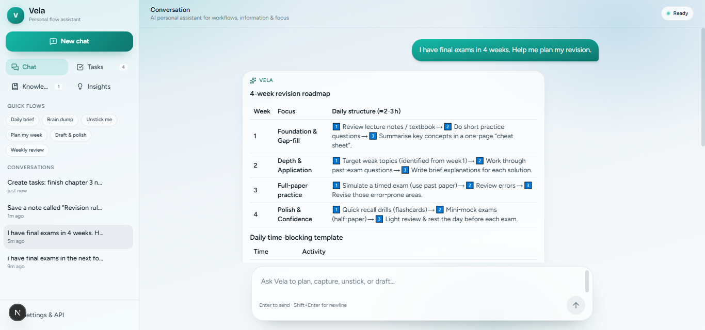
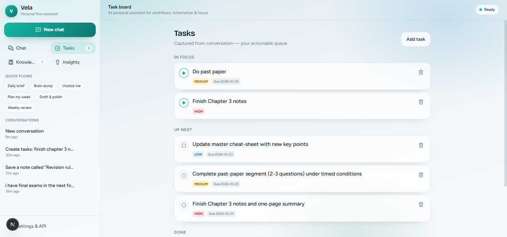
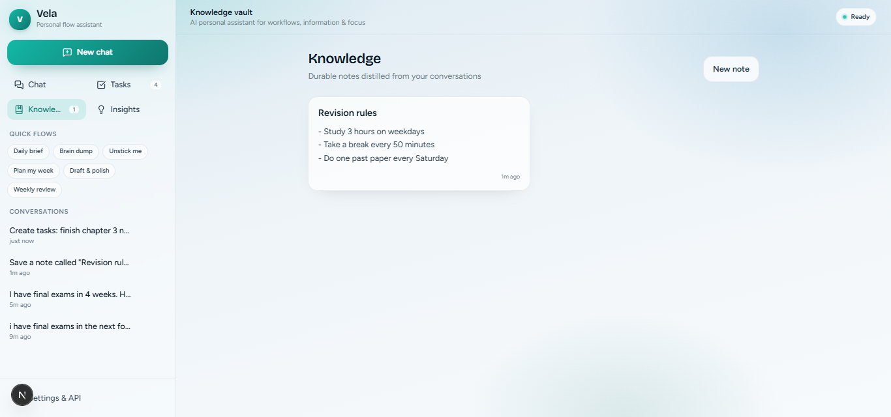
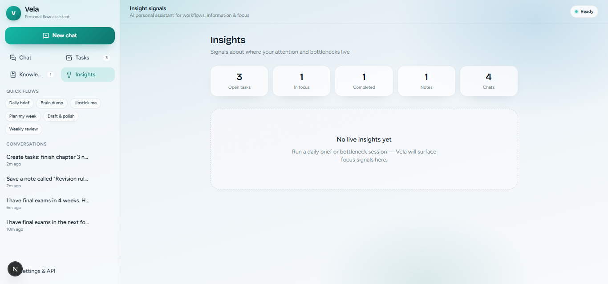

# Vela: AI Personal Assistant (`ai-assistant-chatbot`)

**NYLP AI Hackathon 2026 submission.** Vela is a conversational AI assistant that turns a plain-language message into a plan, tasks, and notes, so people can streamline their daily workflow, keep their information organised, and get past productivity bottlenecks.

| | |
|---|---|
| **Live demo** | `ADD-YOUR-VERCEL-LINK-HERE` |
| **Demo video** | `ADD-YOUR-VIDEO-LINK-HERE` |
| **Repository** | https://github.com/aidahmirembe/ai-assistant-chatbot |
| **Built by** | Mirembe Aidah (solo) |

> Built for this hackathon. Project work started on 15 October 2026.

## Problem

Students and young professionals often have too much to do and no clear plan. A common example is a university student with final exams four weeks away: the work is large, vague, and stressful, and most of the time goes into deciding what to do instead of doing it. Generic chatbots give advice, but the advice disappears into a chat history. Nothing is captured as tasks or notes the person can act on later.

## Solution

Vela is a chat assistant that does not stop at giving advice. When you describe a goal, it replies with a plan **and** turns that plan into real, editable items in your workspace:

- **Tasks** with a priority and a due date
- **Notes** saved in a knowledge vault
- **Insights** about where your attention and bottlenecks are

Example: *"I have final exams in 4 weeks. Help me plan my revision."* Vela returns a week-by-week roadmap and a daily time-blocking template. When asked, it also creates the tasks and a note for your revision rules.

Target users: students and early-career professionals who need structure, especially those with limited time and no personal planner.

## Features

- **Conversational planning** with streaming, markdown-formatted replies
- **Smart actions:** the assistant creates tasks and notes and surfaces insights from the conversation
- **Workspace panels:** Tasks (In focus / Up next / Done), Knowledge vault, Insights
- **Editable workspace:** add tasks and notes by hand, click a task title to rename it, click its priority to change it, and edit notes in place
- **Quick flows:** Daily brief, Brain dump, Unstick me, Plan my week, Draft & polish, Weekly review
- **Offline capture mode:** still captures tasks and gives structured templates when no API key is set
- **Bring your own key:** works with any OpenAI-compatible provider (Groq, OpenAI, OpenRouter)
- **Local-first storage:** chats, tasks, and notes are saved in the browser

## Screenshots

### AI chat: a 4-week revision plan from one message


### Tasks created automatically from the conversation


### Knowledge vault: notes saved by the assistant


### Insights: live workspace stats and focus signals


## AI methodology

The AI is the core of the product. This is how it works:

1. **Language model.** Each message is sent to a large language model through an OpenAI-compatible chat-completions API. The deployed demo uses **`openai/gpt-oss-120b` hosted on Groq**. Any compatible model can be configured.
2. **System prompt.** A detailed system prompt (`src/lib/prompts.ts`) defines Vela's role, tone, and response style, and the rules for when to create tasks and notes.
3. **Context injection.** With every request the app adds the user's name, focus areas, up to 12 open tasks, and up to 8 recent note titles, so replies fit the user's real workload.
4. **Structured actions.** The model ends relevant replies with a hidden fenced JSON block (`vela-actions`). The app (`src/lib/actions.ts`) validates it and turns each entry into a task, a completed task, a note, or an insight. Invalid entries are ignored, and the block is hidden from the visible reply.
5. **Streaming.** The server route (`src/app/api/chat/route.ts`) streams tokens to the browser as they arrive.
6. **Offline fallback.** With no API key, a small rule-based mode (keyword matching, not machine learning) handles brain dumps, daily briefs, bottleneck diagnosis, and weekly plans, so the app stays usable.

**Model/API usage:** the language model provides the understanding, planning, and drafting. The application design (workspace, structured actions, context, error handling) is the author's work.

## Tech stack

- **Framework:** Next.js 16 (App Router), React 19, TypeScript
- **Styling and UI:** Tailwind CSS 4, Framer Motion, Lucide icons
- **State:** Zustand with browser persistence
- **Rendering:** react-markdown with remark-gfm
- **Fonts:** Figtree and Bricolage Grotesque, self-hosted through Fontsource (no external font requests)
- **AI provider:** Groq (OpenAI-compatible API) with `openai/gpt-oss-120b`
- **Hosting:** Vercel

### Third-party AI APIs and open-source libraries

- **Groq API** for model inference (the app also works with OpenAI and OpenRouter)
- Open-source libraries: Next.js, React, Tailwind CSS, Zustand, Framer Motion, Lucide React, react-markdown, remark-gfm, date-fns, nanoid, clsx, Fontsource

AI tools were also used as development assistants while building the project. The author reviewed and tested the result.

## Setup

```bash
git clone https://github.com/aidahmirembe/ai-assistant-chatbot.git
cd ai-assistant-chatbot
npm install
cp .env.example .env.local   # then add your key (never commit this file)
npm run dev
```

Open http://localhost:3000.

### Environment variables

| Name | Purpose | Example |
|---|---|---|
| `OPENAI_API_KEY` | Server-side API key | your provider key |
| `OPENAI_MODEL` | Model name | `openai/gpt-oss-120b` |
| `OPENAI_BASE_URL` | Provider endpoint | `https://api.groq.com/openai/v1` |

You can also paste a key, model, and base URL into **Settings & API** in the app. A key entered there is used instead of the server settings.

### Scripts

| Command | Description |
|---|---|
| `npm run dev` | Start the development server |
| `npm run build` | Production build |
| `npm run start` | Run the production server |
| `npm run lint` | Lint the code |

## Deployment

The app is deployed on Vercel from this repository. Set the three environment variables above in the Vercel project settings, then deploy. The server uses them when a visitor has not entered their own key.

## Privacy, ethics, and security

- **No keys in the repo.** `.env*` files are git-ignored, and `.env.example` is empty.
- **Where data goes.** Chat messages, plus the task titles and note titles shown as context, are sent to the configured model provider to generate replies. Do not enter sensitive personal information.
- **Browser storage.** Tasks, notes, chats, and any key entered in Settings are stored in the browser's `localStorage` on that device only. Use your own key only on your own device.
- **Shared demo key limits.** The server caps the number and length of messages per request to protect the shared demo key.
- **Responsible use.** The assistant gives planning suggestions, not professional advice. Its output can contain mistakes, so review it before relying on it.

## Limitations and future work

- No user accounts or cloud sync: data stays in one browser
- The offline mode is rule-based and only covers a few intents
- AI output can be wrong or inconsistent, and structured actions depend on the model following the format
- Planned: due-date reminders, calendar export, voice input, and optional accounts with sync

## Team contributions

| Member | Role | Contribution |
|---|---|---|
| Mirembe Aidah | Solo builder (all roles) | Idea and problem definition, product design, frontend and backend implementation, AI prompt and structured-action design, testing, deployment, and documentation |

## Acknowledgements

Thanks to NYLP and its partners for organising the AI Hackathon 2026.
